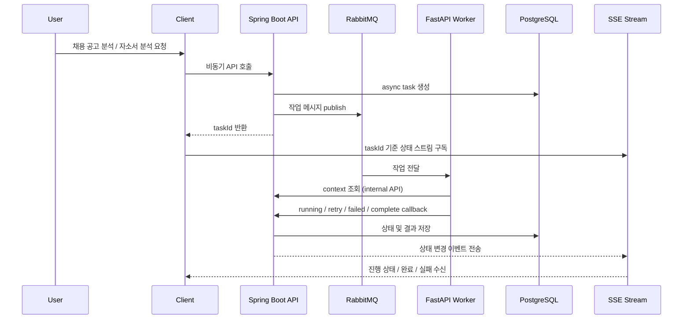

# JobDri SERVER


**AI 기반 채용 공고 정리 · 모의 지원서 생성 · 자소서 분석 플랫폼 `JobDri`의 백엔드 서버**입니다.

> **"채용 공고를 정리하고, 지원서를 만들고, 자소서까지 분석받자."**  
> 사용자가 업로드하거나 입력한 채용 공고를 AI가 구조화하고,  
> 직무/회사 기반의 **모의 공고와 문항**을 생성하며,  
> 작성한 자소서를 **AI 분석 + 실시간 상태 알림**으로 제공하는 **AI 취업 지원 플랫폼**입니다.

Server: `https://api.jobdri.site`

## 📖 프로젝트 소개

`JobDri`는 채용 공고부터 모의 지원, 자소서 분석까지 이어지는 지원 준비 흐름을 하나의 서비스 안에서 제공하는 백엔드입니다.

이 서버는 다음 흐름을 중심으로 동작합니다.

1. **채용 공고 입력/정리**
   사용자가 텍스트 또는 이미지 기반 공고를 입력하면 AI가 회사명, 직무명, 주요 업무, 자격 요건, 우대 사항을 구조화합니다.
2. **공고 저장 및 모의 지원 생성**
   저장된 실제 공고 또는 AI가 만든 모의 공고를 기반으로 `MockApply`를 생성하고, 추천 문항 또는 직접 추가 문항을 선택해 지원서를 작성합니다.
3. **자소서 분석**
   작성한 답변을 AI가 비동기로 분석하고, 점수/피드백/문항별 코멘트/누락 키워드를 저장합니다.
4. **실시간 상태 추적**
   긴 작업은 `RabbitMQ + 외부 FastAPI worker + internal callback API + SSE` 구조로 처리하며, 사용자는 진행 상태와 완료 알림을 실시간으로 확인할 수 있습니다.

## Contributors

<table>
  <tr>
    <td align="center" width="220">
       
      <br />
      <strong><a href="https://github.com/shinae1023">@shinae1023</a></strong>
      <br />
      <br />
      <sub>역할입력</sub>
    </td>
    <td align="center" width="220">
      
      <br />
      <strong><a href="https://github.com/whc9999">@whc9999</a></strong>
      <br />
      <br />
      <sub>역할입력</sub>
    </td>
  </tr>
</table>


## 🔄 Core Flow

### 1. 채용 공고 처리

- `POST /api/job-postings/extract`
  텍스트 또는 S3 이미지 object key를 받아 AI가 공고를 추출합니다.
- `POST /api/job-postings/ingest`
  공고 추출 → 분류 후보 탐색 → 공고 초안 생성 → 저장까지 비동기 작업으로 접수합니다.
- `GET /api/job-postings/ingest/async/{taskId}`
  비동기 상태를 조회합니다.
- `GET /api/job-postings/ingest/async/{taskId}/stream`
  SSE로 상태 변화를 구독합니다.
- `POST /api/job-applications/ingest`
  Clipper의 텍스트 또는 이미지를 지원관리 카드로 직접 등록합니다. 저장 공고·모의지원·분석은 생성하지 않으며 요청 멱등 키를 지원합니다.
- `POST /api/job-applications/{jobApplicationId}/mock-apply`
  준비된 지원 카드 스냅샷으로 분석용 공고와 실제 공고형 모의지원을 한 번만 생성합니다.

### 2. 모의 지원서 생성

- 저장된 실제 공고 기반 `ACTUAL` 타입 모의 지원 생성
- 저장된 공고 기반 `MOCK` 타입 모의 지원 생성
- 회사/직무 분류 기반 가상 공고 생성과 추천 질문 생성
- 같은 공고 기준 회차(`sequence`) 관리 및 재도전 생성

### 3. 자소서 작성 및 분석

- 문항 후보 조회, 직접 문항 추가, 선택 문항 저장
- 답변 저장/수정
- `POST /api/mock-applies/{mockApplyId}/analysis`
  자소서 분석 비동기 작업 접수
- `GET /api/mock-applies/{mockApplyId}/analysis`
  저장된 분석 결과 조회
- `GET /api/mock-applies/{mockApplyId}/analysis/async/{taskId}/stream`
  SSE 상태 스트림 구독

## 🛠️ Tech Stack

| Category | Stack |
| --- | --- |
| **Language** | Java 21 |
| **Framework** | Spring Boot 3.5.14 |
| **ORM / DB** | Spring Data JPA, PostgreSQL, H2(Test), pgvector |
| **Cache / Messaging** | Redis, RabbitMQ |
| **Auth / Security** | Spring Security, JWT, Google OAuth2 |
| **AI / Embedding** | OpenAI API (`gpt-4o-mini` default), Cohere Embedding (`embed-v4.0`) |
| **Storage / Infra** | AWS S3, Docker, GHCR, EC2, Nginx |
| **Payment** | Toss Payments |
| **Mail / Realtime** | JavaMailSender(Gmail SMTP), SSE |
| **Docs / Build** | SpringDoc Swagger, Gradle, GitHub Actions |

## Cohere Embed API 로컬 검증

Cohere 임베딩 클라이언트는 `COHERE_API_KEY` 환경변수를 통해 API key를 읽습니다. 값이 없어도 애플리케이션 기동은 실패하지 않지만, 실제 임베딩 호출 시 명확한 예외가 발생합니다.

```bash
export COHERE_API_KEY='실제_API_키'
```

기본 설정:

- endpoint: `POST https://api.cohere.com/v2/embed`
- model: `embed-v4.0`
- output dimension: `1024`
- document input type: `search_document`
- query input type: `search_query`
- embedding type: `float`

초기 검증용 텍스트:

```text
Spring Boot 기반 REST API 개발 및 PostgreSQL 성능 최적화
```

기본 테스트 스위트는 실제 Cohere API를 호출하지 않습니다. 수동 검증이 필요하면 `COHERE_API_KEY`를 설정한 뒤 Spring 컨텍스트에서 `CohereEmbeddingClient.embedDocuments(...)` 또는 `embedQuery(...)`를 호출해 반환 벡터 차원이 1024인지 확인합니다. 전체 embedding 값이나 API key는 로그에 남기지 않습니다.

## ✨ Key Features

### 1. 인증 및 사용자 관리

- 이메일 인증번호 발송/검증 기반 회원가입
- JWT Access/Refresh Token 로그인 및 재발급
- Redis 기반 로그아웃/토큰 무효화 처리
- Google OAuth2 로그인 및 프론트 리다이렉트 연동

### 2. 채용 공고 AI 처리

- 공고 텍스트/이미지에서 구조화 정보 추출
- S3 presigned PUT URL 기반 이미지 직접 업로드
- 직무 소분류 자동 분류 후보 추천
- 회사/직무 기반 실제 공고 초안 생성
- 회사/직무 기반 모의 공고 및 추천 질문 생성

### 3. 모의 지원서 작성 흐름

- 실제 공고 기반 `ACTUAL` 타입 지원 생성
- 생성 공고 기반 `MOCK` 타입 지원 생성
- 질문 후보 조회 및 직접 문항 추가
- 선택 문항 저장 후 답변 작성 단계 전환
- 공고별 회차 관리 및 재도전 지원

### 4. 자소서 분석

- 비동기 분석 작업 접수 및 상태 조회
- 분석 완료 시 종합 점수, 항목별 점수, 전체 피드백 저장
- 문항별 분석 결과와 누락 키워드 제공
- 분석 실행 시 크레딧 1회 차감, 실패 시 환불

### 5. 결제 및 크레딧

- 크레딧 플랜 조회
- 토스페이먼츠 결제 준비/승인
- 사용자 크레딧 잔액/거래 내역 조회
- 기본 플랜
  `1회권`, `5회권`, `10회권`

### 6. 실시간 알림

- SSE 기반 인앱 알림 스트림
- 미읽음 개수 조회
- 개별/전체 읽음 처리
- 현재 구현된 주요 알림 타입
  `JOB_POSTING_ASYNC_SUCCEEDED`, `JOB_POSTING_ASYNC_FAILED`, `ANALYSIS_ASYNC_SUCCEEDED`, `ANALYSIS_ASYNC_FAILED`

### 7. 관리자 / 운영 기능

- corpus xlsx 적재 API
- corpus embedding 동기화 API
- 분석 retrieval preview 디버그 API
- 부트스트랩 관리자 이메일 승격
- 비동기 task timeout sweep 스케줄러
- 감사 로그 AOP (`@AuditLogEvent`)


## 🏛️ System Architecture

### 1. 전체 서버 아키텍처

```mermaid
%% Generated by https://gitdiagram.com/jobdri-developer/backend
flowchart TD

subgraph group_posting["Posting intake"]
  node_posting_ingest["Posting ingest"]
  node_posting_ai["Posting AI"]
  node_classification["Job classification"]
  node_posting_store[("Job postings<br/>[JobPosting.java]")]
  node_image_storage["Image upload"]
end

subgraph group_applications["Application preparation"]
  node_application_ingest["Application-card intake"]
  node_application_persist["Application persistence"]
  node_application_store[("Application cards")]
  node_mock_apply["Mock applications"]
  node_questions["Question selection"]
end

subgraph group_analysis["Analysis pipeline"]
  node_analysis_submit["Analysis submission"]
  node_analysis_async["Async orchestration"]
  node_worker_callback["Worker callbacks"]
  node_analysis_ai["Analysis AI"]
  node_analysis_results[("Analysis results<br/>[Analysis.java]")]
  node_sse["Progress streams"]
end

subgraph group_platform["Platform services"]
  node_api["Spring API"]
  node_notifications["In-app notifications"]
  node_auth["Authentication<br/>[AuthService.java]"]
  node_users[("User accounts<br/>[User.java]")]
  node_payments["Credits and payment"]
  node_corpus["Corpus retrieval"]
  node_corpus_store[("Corpus data")]
  node_admin["Corpus operations"]
end

node_client(("User client"))
node_s3[("AWS S3")]
node_rabbit["RabbitMQ"]
node_worker["External worker"]
node_openai["OpenAI"]
node_toss["Toss Payments"]

node_client -->|"REST requests"| node_api
node_client -->|"requests upload URL"| node_image_storage
node_image_storage -->|"presigns upload"| node_s3
node_client -->|"uploads image"| node_s3
node_api -.->|"routes ingest"| node_posting_ingest
node_posting_ingest -->|"extracts and generates"| node_posting_ai
node_posting_ingest -->|"finds candidates"| node_classification
node_posting_ingest -->|"saves posting"| node_posting_store
node_posting_ai -.->|"calls AI"| node_openai
node_api -->|"routes intake"| node_application_ingest
node_application_ingest -->|"extracts and generates"| node_posting_ai
node_application_ingest -->|"finds candidates"| node_classification
node_application_ingest -.->|"persists card"| node_application_persist
node_application_persist -->|"saves card"| node_application_store
node_client -->|"creates mock apply"| node_mock_apply
node_mock_apply -->|"uses saved posting"| node_posting_store
node_client -->|"selects questions"| node_questions
node_questions -->|"checks ownership"| node_mock_apply
node_questions -.->|"reads question records"| node_analysis_results
node_client -->|"submits analysis"| node_analysis_submit
node_analysis_submit -.->|"starts async task"| node_analysis_async
node_analysis_async -->|"publishes task"| node_rabbit
node_rabbit -->|"delivers task"| node_worker
node_worker -->|"posts callbacks"| node_worker_callback
node_worker_callback -.->|"stores result"| node_analysis_results
node_worker_callback -.->|"updates progress"| node_sse
node_analysis_async -.->|"serves stream"| node_sse
node_sse -->|"streams status"| node_client
node_analysis_ai -.->|"requests analysis"| node_openai
node_analysis_async -.->|"generates analysis"| node_analysis_ai
node_worker_callback -->|"notifies completion"| node_notifications
node_notifications -->|"streams alerts"| node_client
node_client -->|"authenticates"| node_auth
node_auth -.->|"manages accounts"| node_users
node_client -->|"buys credits"| node_payments
node_payments -->|"confirms payment"| node_toss
node_analysis_async -.->|"charges credits"| node_payments
node_admin -.->|"syncs embeddings"| node_corpus
node_corpus -->|"retrieves examples"| node_corpus_store

click node_api "https://github.com/jobdri-developer/backend/blob/dev/src/main/java/com/jobdri/jobdri_api/JobdriApiApplication.java"
click node_posting_ingest "https://github.com/jobdri-developer/backend/blob/dev/src/main/java/com/jobdri/jobdri_api/domain/jobposting/service/JobPostingIngestService.java"
click node_posting_ai "https://github.com/jobdri-developer/backend/blob/dev/src/main/java/com/jobdri/jobdri_api/domain/jobposting/service/JobPostingIngestService.java"
click node_classification "https://github.com/jobdri-developer/backend/blob/dev/src/main/java/com/jobdri/jobdri_api/domain/classification/service/ClassificationService.java"
click node_posting_store "https://github.com/jobdri-developer/backend/blob/dev/src/main/java/com/jobdri/jobdri_api/domain/jobposting/entity/JobPosting.java"
click node_image_storage "https://github.com/jobdri-developer/backend/blob/dev/src/main/java/com/jobdri/jobdri_api/domain/jobposting/service/JobPostingImageStorageService.java"
click node_application_ingest "https://github.com/jobdri-developer/backend/blob/dev/src/main/java/com/jobdri/jobdri_api/domain/jobapplication/service/JobApplicationIngestService.java"
click node_application_persist "https://github.com/jobdri-developer/backend/blob/dev/src/main/java/com/jobdri/jobdri_api/domain/jobapplication/service/JobApplicationIngestPersistenceService.java"
click node_application_store "https://github.com/jobdri-developer/backend/blob/dev/src/main/java/com/jobdri/jobdri_api/domain/jobapplication/service/JobApplicationIngestPersistenceService.java"
click node_mock_apply "https://github.com/jobdri-developer/backend/blob/dev/src/main/java/com/jobdri/jobdri_api/domain/mockapply/service/MockApplyService.java"
click node_questions "https://github.com/jobdri-developer/backend/blob/dev/src/main/java/com/jobdri/jobdri_api/domain/analysis/service/question/QuestionQueryService.java"
click node_analysis_submit "https://github.com/jobdri-developer/backend/blob/dev/src/main/java/com/jobdri/jobdri_api/domain/analysis/controller/AnalysisController.java"
click node_analysis_async "https://github.com/jobdri-developer/backend/blob/dev/src/main/java/com/jobdri/jobdri_api/domain/analysis/service/async/AnalysisAsyncFacadeService.java"
click node_worker_callback "https://github.com/jobdri-developer/backend/blob/dev/src/main/java/com/jobdri/jobdri_api/domain/analysis/controller/AnalysisWorkerInternalController.java"
click node_analysis_ai "https://github.com/jobdri-developer/backend/blob/dev/src/main/java/com/jobdri/jobdri_api/domain/analysis/infrastructure/ai/OpenAiAnalysisAdapter.java"
click node_analysis_results "https://github.com/jobdri-developer/backend/blob/dev/src/main/java/com/jobdri/jobdri_api/domain/analysis/entity/Analysis.java"
click node_sse "https://github.com/jobdri-developer/backend/blob/dev/src/main/java/com/jobdri/jobdri_api/domain/analysis/service/async/AnalysisAsyncSseService.java"
click node_notifications "https://github.com/jobdri-developer/backend/blob/dev/src/main/java/com/jobdri/jobdri_api/domain/notification/service/NotificationSseService.java"
click node_auth "https://github.com/jobdri-developer/backend/blob/dev/src/main/java/com/jobdri/jobdri_api/domain/auth/service/AuthService.java"
click node_users "https://github.com/jobdri-developer/backend/blob/dev/src/main/java/com/jobdri/jobdri_api/domain/user/entity/User.java"
click node_payments "https://github.com/jobdri-developer/backend/blob/dev/src/main/java/com/jobdri/jobdri_api/domain/payment/service/PaymentService.java"
click node_corpus "https://github.com/jobdri-developer/backend/blob/dev/src/main/java/com/jobdri/jobdri_api/domain/corpus/service/CorpusRetrievalService.java"
click node_corpus_store "https://github.com/jobdri-developer/backend/blob/dev/src/main/java/com/jobdri/jobdri_api/domain/corpus/entity/MockJobPostingCorpus.java"
click node_admin "https://github.com/jobdri-developer/backend/blob/dev/src/main/java/com/jobdri/jobdri_api/domain/corpus/controller/CorpusAdminController.java"

classDef toneNeutral fill:#f8fafc,stroke:#334155,stroke-width:1.5px,color:#0f172a
classDef toneBlue fill:#dbeafe,stroke:#2563eb,stroke-width:1.5px,color:#172554
classDef toneAmber fill:#fef3c7,stroke:#d97706,stroke-width:1.5px,color:#78350f
classDef toneMint fill:#dcfce7,stroke:#16a34a,stroke-width:1.5px,color:#14532d
classDef toneRose fill:#ffe4e6,stroke:#e11d48,stroke-width:1.5px,color:#881337
classDef toneIndigo fill:#e0e7ff,stroke:#4f46e5,stroke-width:1.5px,color:#312e81
classDef toneTeal fill:#ccfbf1,stroke:#0f766e,stroke-width:1.5px,color:#134e4a
class node_posting_ingest,node_posting_ai,node_classification,node_posting_store,node_image_storage,node_client toneBlue
class node_application_ingest,node_application_persist,node_application_store,node_mock_apply,node_questions,node_s3 toneAmber
class node_analysis_submit,node_analysis_async,node_worker_callback,node_analysis_ai,node_analysis_results,node_sse toneMint
class node_api,node_notifications,node_auth,node_users,node_payments,node_corpus,node_corpus_store,node_admin,node_worker toneRose
class node_rabbit,node_openai,node_toss toneIndigo


```



### 2. 비동기 워커 처리 흐름



## 🔁 Async Worker Flow

이 서버의 핵심 비동기 작업은 `채용 공고 ingest`와 `자소서 분석` 두 종류입니다.

1. 사용자가 비동기 API를 호출합니다.
2. Spring 서버가 task row를 생성합니다.
3. Spring 서버가 RabbitMQ exchange/queue로 작업 메시지를 publish 합니다.
4. 외부 FastAPI worker가 메시지를 consume 합니다.
5. worker는 필요 컨텍스트를 internal API로 조회합니다.
6. worker가 AI 처리 결과를 internal callback API로 완료/실패 반영합니다.
7. Spring 서버가 DB 저장, 알림 생성, SSE 상태 전파를 수행합니다.

## 📈 Observability Notes

- `ops/observability/prometheus.yml`의 `analysis_worker` scrape job은 `worker:8000/metrics`를 기본값으로 사용합니다.
- 이 설정은 Docker Compose 안의 `worker` 서비스가 별도 FastAPI worker 이미지를 실행하고, 그 이미지가 `0.0.0.0:8000`에서 `/metrics`를 노출할 때만 유효합니다.
- 이 repo 루트의 [Dockerfile](/Users/shinae/Desktop/ceos/Dockerfile)는 Spring Boot API 이미지용이며 `8080`만 노출합니다. 즉, 루트 Dockerfile만 기준으로 보면 `analysis_worker` target의 `/metrics`는 제공되지 않습니다.
- 배포 환경의 worker 이미지가 `/metrics`를 열지 않는다면 Prometheus에서 `analysis_worker` target은 `DOWN`으로 보일 수 있습니다.
- 이 경우에는 `analysis_worker` scrape target을 실제 worker metrics endpoint로 바꾸거나, 아직 worker metrics를 배포하지 않았다면 해당 job을 제거한 뒤 API 메트릭만 먼저 수집하는 구성이 맞습니다.

## 📂 Project Structure

```bash
com.jobdri.jobdri_api
├── domain
│   ├── analysis        # 자소서 분석, 질문 선택, async task, worker bridge
│   ├── auth            # 회원가입, 로그인, 이메일 인증, OAuth2
│   ├── classification  # 대/중/소분류 직무 체계 조회
│   ├── company         # 회사 엔티티
│   ├── corpus          # corpus 적재, 임베딩 동기화, retrieval
│   ├── jobposting      # 공고 저장/수정/생성/추출/ingest/extension 연동
│   ├── mockapply       # 모의 지원 생성, 회차, 재도전
│   ├── notification    # SSE 알림, 읽음 처리
│   ├── payment         # 크레딧, 결제, 거래 내역
│   ├── audit           # 감사 로그 AOP
│   ├── user            # 사용자 도메인
│   └── skill / experience
├── global
│   ├── apiPayload      # 공통 응답/에러 코드
│   ├── config          # Security, Swagger, RabbitMQ, AWS S3, Async 설정
│   ├── jwt             # JWT 필터/유틸
│   ├── mq              # RabbitMQ publish support
│   ├── scheduling      # async timeout sweep scheduler
│   ├── security        # UserDetails, internal API key validator
│   └── sse             # SSE subscription registry
└── resources
    ├── application*.yaml
    └── schema.sql
```

## 🧠 Corpus / Retrieval

이 프로젝트는 단순 LLM 호출만 사용하는 구조가 아니라, corpus 기반 retrieval를 함께 사용합니다.

- 채용 공고 corpus 적재
- 질문 corpus 적재
- Cohere 임베딩 생성
- pgvector 저장
- 모의 공고 생성 및 자소서 분석 시 retrieval context 참고
- 관리자 preview API로 retrieval 결과 사전 점검 가능

## 📌 현재 구현 범위

- 이메일 인증 기반 로컬 회원가입/로그인
- Google OAuth2 로그인
- JWT 인증/인가 및 로그아웃 처리
- 직무 대/중/소분류 조회
- 채용 공고 생성/수정/조회/삭제
- 채용 공고 이미지 presigned upload
- AI 채용 공고 추출
- AI 채용 공고 초안 생성
- AI 모의 공고 생성
- 추천 질문 캐시 및 조회
- 실제/모의 공고 기반 모의 지원 생성
- 질문 선택, 직접 문항 추가, 답변 저장
- 자소서 분석 비동기 처리
- 크레딧 차감/환불
- 토스 결제 연동
- SSE 알림
- 관리자 corpus import / embedding sync
- RabbitMQ 기반 외부 worker 연동용 internal API
- async timeout sweep scheduler
- 감사 로그 적재
